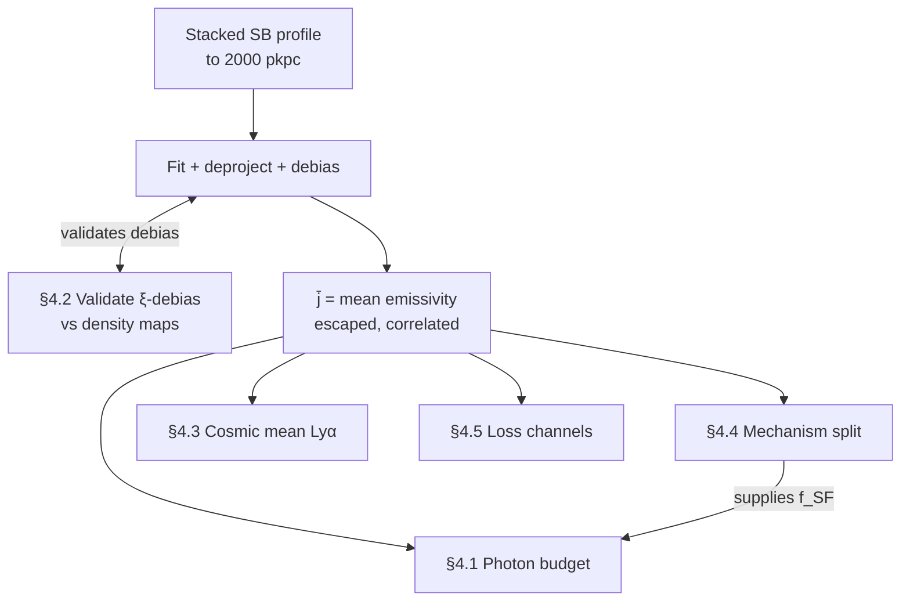

# The 2-halo Lyα photon budget

> [!abstract] What this note is
> The physics, assumptions, and measurement paths that turn a stacked Lyα surface-brightness
> profile into a mean emissivity and everything that emissivity could imply. Literature now
> lives in a separate synthesis note per source — this note is the current work and the
> current numbers only.

> [!warning] The grounding rule
> Every number needs a stated provenance and regime before it's used. A result that looks
> clean is usually the assumption talking — see §8.

---

## 1. What we are actually looking at

We stack Lyα around ~z = 2.3 galaxies out to **2000 pkpc (6.6 cMpc)** — the current
default/maximum distance with acceptable systematics. Beyond ~75 kpc the profile is
dominated by the **2-halo term**: light correlated with the galaxy but not bound to it.

**The subject is the cosmic web, not the central galaxy.** At Mpc separations we are
measuring the galaxy's *environment* — satellites, small/intermediate-mass halos, and
whatever diffuse gas emits in between.

---

## 2. The chain

| # | Step | Key assumption |
|---|---|---|
| 1 | Stack SB profiles, background-subtracted | Removes the cosmic mean, leaving the *correlated excess*. This step also silently assumes everything upstream — reduction, stacking, background subtraction — is correct. That's the single largest assumption the whole chain rests on. |
| 2 | Fit the **full profile**: exponential core (single-halo, $h_1$) + large-scale power law (2-halo, $A_2/r_c$), 2-halo projected slope fixed at $\gamma_{2d}=0.8$ | A choice, not a measurement — flagged, not resolved: $0.8\to\gamma_{3d}=1.8$ happens to equal the assumed $\gamma_\xi$ (a circularity in the *shape*, not the normalisation) |
| 3 | Deproject 2D → 3D (Abel-type relation) | $\gamma_{3d}=\gamma_{2d}+1=1.8$ |
| 4 | Divide by the galaxy correlation function $\xi_{\rm gal}$ | Debias is $/\xi$, **not** $/(1+\xi)$ — background subtraction already removed the mean. Requires $r_0,\gamma_\xi$ (Bielby+2016). Validated against real density maps, not just assumed — §4.2 |
| 5 | Report the mean emissivity $\bar{j}$ | This is the **escaped** emissivity — no escape fraction enters the deprojection, it's built entirely from photons that reached the telescope |
| 6 | Convert Lyα → SFR via case B + Kennicutt | Case B ratio 8.7; Kennicutt Hα calibration. **The IMF here must match the IMF the cosmic SFRD compilation in step 7 assumes** — not MOSDEF's own per-galaxy SED-fit SFRs, which are a different, unrelated quantity and don't matter here |
| 7 | Compare to the cosmic SFRD | Madau & Dickinson, 0.1231 at z = 2.3 |

Current fit (step 2):

```
chi2/dof = 4.05/8 = 0.51
A1  = 8.496e+39 ± 8.39e+38
h1  = 14.44 ± 1.04
A2  = 8.184e+37 ± 1.73e+37
r_c = 359.6 ± 141
gamma = 0.8 ± 0 (fixed)
```

$A_2$ and $r_c$ are individually degenerate; only $A_2 r_c^{\gamma_{2d}}=9.070\times10^{39}$
enters, stable across the fit's $r_c$ range.

---

## 3. Two things stand between $\bar{j}$ and any conclusion

$$\bar{j}_{\rm true} = \bar{j}_{\rm measured} \times B, \qquad
\bar{j}_{\rm true} = f_{\rm esc}\,\bar{j}_{\rm SF,int} + \bar{j}_{\rm nonSF}$$

- **$f_{\rm SF}$** — the fraction of the emission that is escaped *stellar* light (case-B,
  star-formation-sourced — H1, wherever it physically happens) rather than in-situ
  non-stellar emission. Currently assumed 1.
- **$B \equiv \xi_{\rm gal}/\xi_{\rm eff}$** — the ratio of the galaxy correlation function we
  divided by to the *actual* spatial distribution of the Lyα-emitting material. A real,
  physical correction. Currently assumed 1, with no justification.

Star-formation-sourced light (H1 — including satellites, not just the falsified
central-galaxy picture, H2) clusters more tightly around galaxies than galaxies cluster
around each other: it raises $f_{\rm SF}$ *and* pushes $B$ below 1, in the same direction. The
§4.1 grid should be read as a band, not independent cells.

Two independent slopes support $B<1$ in sign: Chen 2020's HI absorption equivalent-width
slope ($\beta=-0.48\pm0.02$, 300–2000 pkpc) and Austin's informal free-$\beta$ refit
($\gamma_{2d}\approx0.6$, not yet official) both come out shallower than the assumed
$\gamma_{2d}=0.8$. Over the actual fit range, that slope difference alone only shifts $B$ by a
few percent — not enough by itself to explain a large deviation from 1. The real amplitude
offset still needs §4.2's density-map check.

---

## 4. The branches — what $\bar{j}$ could mean



### 4.1 The star-formation budget

$$f_{\rm esc}^{\rm required} = f_{\rm SF} \times B \times 1.069$$

> [!warning] 1.069 is a point estimate
> Its own error bars are larger than the third decimal implies. There's a real probability
> (>50%) the true value is *higher*, not lower — which strengthens the exclusion argument
> below, not weakens it.

| | $B=1.1$ | $B=1.0$ | $B=0.9$ | $B=0.5$ |
|---|---|---|---|---|
| $f_{\rm SF}=1.0$ | **1.18** ✗ | **1.07** ✗ | 0.962 | 0.535 |
| $f_{\rm SF}=0.7$ | 0.823 | 0.748 | 0.673 | 0.374 |
| $f_{\rm SF}=0.5$ | 0.588 | 0.534 | 0.481 | 0.267 |
| $f_{\rm SF}=0.2$ | 0.235 | 0.214 | 0.192 | 0.107 |
| $f_{\rm SF}=0.1$ | 0.118 | 0.107 | 0.0962 | 0.053 |

Two cells excluded at the central estimate ($f_{\rm SF}=1.0$, $B\geq1.0$) — both need
$f_{\rm esc}>1$ for star formation alone. Given 1.069's uncertainty, treat the boundary as
soft ($B\approx0.85$–$1.0$), not sharp. Any $f_{\rm SF}\lesssim0.9$ or $B\lesssim0.9$ revives
star formation on its own — this is the degeneracy the literature has to break.

### 4.2 Validate the ξ-debias against real density maps

A confirmation check, not a new number — and the natural partner to step 4/§2 (hence the loop
in the diagram: fit → debias → validate → refit if needed). Step 4 divides by an *assumed*
external correlation function; the fix is an independently measured $\delta(x)$ at our own
galaxy positions, regressed against the observed SB, so the debias isn't checked against
another assumed power law.

- **Requires:** Chartab 2020 / Hatamnia 2026 density maps — adaptive von Mises(-Fisher) KDE,
  bandwidth ~0.26 $h^{-1}$ Mpc comoving at $z\sim1$, grows with $z$; the $z\sim2.3$ value
  still needs pulling from their Figure 4. Reuses the existing overdensity-split project's
  catalog, repurposed to check the debias rather than compare environments.
- **Output:** confirms $\xi_{\rm gal}\approx\xi_{\rm eff}$ at our positions, or corrects it —
  feeds $B$ directly.
- **Status:** not started.

### 4.3 Recovering the cosmic mean Lyα background

The most interesting branch, and the one nobody hands us — the number to calculate and
report, once §4.2 is validated. The cosmic mean is the "+1" background subtraction always
removes, conventionally undetectable. We have a profile that falls to zero at large radius, a
measured amplitude, and (once §4.2 is done) an independent $\xi$ from the density field —
which makes the removed normalisation solvable rather than degenerate.

- **Compare method:** Zhang 2026 (CLAMATO×galaxies, absorption not emission, same $(1+\xi)$
  bookkeeping; also reports $b_g\approx2.1$–3.8, a cross-check on the Bielby amplitude).
- **External anchor:** Croft 2018, Mas-Ribas 2017.
- **Status:** speculative — write down what would falsify it first.

### 4.4 The emission mechanisms

| | Hypothesis | Status | Discriminant |
|---|---|---|---|
| **H1** | In-situ star formation / satellites | Open, leading | Lyα-inferred SFR vs. simulations: ratio $>1$ means other sources are contributing to the Lyα |
| **H2** | Light from the central/core galaxy reaching Mpc scales | **Falsified** | Measured single-to-2-halo profile transition (§1); photon-budget implausibility; literature attributes 2-halo signal to satellites |
| **H3** | Collisional excitation / CGM cooling | Open, leading | Amplitude ∝ halo mass — larger mass → larger halo → greater potential → more gravity/cooling → environment/mass split |
| **H4** | UVB fluorescence | Contributor only | ≤10–34% (Bacon+2021) |
| **H5** | $A_2$ or $B$ over-estimated — not physics | Open, testable now | Rule out background-subtraction systematics, confirm sufficient S/N, validate $B$ via environment (§4.2) |

#### Mechanism fractions × shared escape fraction

If the three intrinsic channels (H3 cooling, H4 fluorescence, H1 star formation) share one
escape fraction, it cancels out of $f_{\rm SF}$ entirely — $f_{\rm SF}$ becomes just the
intrinsic production mix. But the shared escape fraction still sets whether that implied
intrinsic SF production exceeds the Case-B/Kennicutt SFRD budget:

$$\frac{f_{\rm SF}\times1.069}{f_{\rm esc,shared}} \;(\text{assumes } B=1)$$

| $f_{\rm SF}$ | Cooling (H3) | Fluorescence (H4) | Star formation (H1) | $f_{\rm esc}=1.0$ | $0.5$ | $0.2$ | $0.1$ | $0.05$ |
|---|---|---|---|---|---|---|---|---|
| 1.0 | 0% | 0% | 100% | **1.07** ✗ | **2.14** ✗ | **5.35** ✗ | **10.7** ✗ | **21.4** ✗ |
| 0.7 | 20% | 10% | 70% | 0.748 | **1.50** ✗ | **3.74** ✗ | **7.48** ✗ | **15.0** ✗ |
| 0.5 | 30% | 20% | 50% | 0.534 | **1.07** ✗ | **2.67** ✗ | **5.35** ✗ | **10.7** ✗ |
| 0.2 | 60% | 20% | 20% | 0.214 | 0.428 | **1.07** ✗ | **2.14** ✗ | **4.28** ✗ |
| 0.1 | 70% | 20% | 10% | 0.107 | 0.214 | 0.534 | **1.07** ✗ | **2.14** ✗ |

Cells > 1 need $f_{\rm esc}>1$ for star formation specifically — excluded, same logic as
§4.1. Mirror image of that grid: there, low $B$ revived star formation; here, low shared
escape *disfavours* it unless the mechanism mix is also SF-poor.

> [!caution] Assumptions stacked here
> Shared escape fraction across channels is an assumption, not a measurement — geometry could
> break it. $B=1$ throughout; combining both grids into one 3D version is a future extension.

### 4.5 Where the missing photons went

**Dust destruction** (real, irreversible) — HI scatters Lyα, dust destroys it. A low escape
fraction means dust, not that the filaments ate the photons.

**Scattering out of the aperture** — probably minor: our bins run to ~1 physical Mpc, no halo
is that big, so what we measure is satellite clustering, not one object's photons escaping
the aperture. Not yet checked at the outer (shell, not disc) bins.

---

## 5. Provenance of key numbers

| Number | Value | Source |
|---|---|---|
| $A_2 r_c^{\gamma_{2d}}$ | $9.070\times10^{39}$ | Our fit |
| $\gamma_{2d}$ | 0.8 (fixed) / ≈0.6 (free, informal) | Our choice / Austin ~2026-07, not official |
| $r_0$, $\gamma_\xi$ | 4.700 cMpc, 1.8 | Bielby+2016 |
| Chen $\beta$ | $-0.48\pm0.02$ (300–2000 pkpc) | Chen+2020, projected EW slope not density |
| case B → SFR | $9.1\times10^{-43}$ | Kennicutt98 / 8.7 (Salpeter; Chabrier ×1.7) |
| Croft limit | $\mu<1.2\times10^{-22}$ | Croft+2018, 95% UL → $B\le0.044$, provisional |
| SFRD | 0.1231 at z=2.3 | Madau & Dickinson |
| $h$ | 0.7 | |

---

## 6. Testable now

- [ ] Refit $\gamma_{2d}$ free, officially (informal: ≈0.6)
- [ ] Rule out background-subtraction systematics, confirm sufficient S/N, validate $B$ via
      environment (§4.2) → H5
- [ ] Lyα-inferred SFR vs. simulations (ratio $>1$ ⟹ other sources contributing) → H1
- [ ] Environment split at fixed M\* — discriminates H3 (amplitude ∝ halo mass/potential)
      from H1 (the satellite-star-formation test above, via the inferred-SFR/simulation ratio)
- [ ] Pull density maps at our positions (§4.2); confirm $z\sim2.3$ bandwidth first

---

## 7. Errors kept deliberately

1. Inverted escape-fraction logic once — $\bar{j}$ is **escaped**, so a smaller $f_{\rm esc}$
   makes the implied SFRD *larger*, not smaller.
2. Imported a galaxy-aperture $f_{\rm esc}$ (Hayes+2011) as if it were global — it isn't a
   like-for-like quantity.
3. Quoted "~20× more than SFRD can supply" as a finding — it's the single excluded corner of
   an open grid, not a discrepancy.

Two manufactured agreement, one manufactured disagreement. Same failure, opposite signs.

---

## 8. What we are (and aren't) claiming

- **Somewhat a measurement of the cosmic SFRD** — the chain does produce an SFRD-comparable
  number, but it's still carrying real, unresolved caveats ($f_{\rm SF}$, $B$, the IMF match).
  Treat it as a constrained, assumption-dependent estimate, not a clean detection — worth
  treading carefully around, not dismissing outright either.
- Not a measurement of a global Lyα escape fraction.
- Not a discrepancy with the cosmic SFRD either — agreement and disagreement both come from
  the same untested corner ($f_{\rm SF}$, $B$).

---

## Next

1. Refit $\gamma_{2d}$ free, officially.
2. Run the §6 tests in parallel.
3. Pull density maps at our galaxy positions (§4.2).
